# Web Config Editor Guide

The web editor (`web/`) is a zero-dependency browser UI for creating, editing,
validating, and running agentic-tool config files. It needs no npm, no build
step, and no project dependencies — just the Python standard library.

All screenshots in this guide were captured with **Playwright** while driving
the real UI through the workflow below, using `examples/simple.json` as the
demo config.

## Launching

```bash
./scripts/run_web.sh                 # Linux/macOS
scripts\run_web.bat                  # Windows
# options: --port <n>, --no-browser
```

The editor opens at `http://127.0.0.1:8765` (loopback only — it can write files
to disk by design, so never expose it beyond loopback). Relative config paths
resolve against the project root.

## Layout

The window has three zones:

- **Toolbar** — `New`, `Open…`, `Save`, `Preview`, `MCP Connectors`, a
  separator, then `▶ Play` / `■ Stop` (enabled only on the Execute tab) and the
  current file label.
- **Status bar** — validation errors, save/open results, run state.
- **Three tabs** — `Settings`, `Tasks`, `Execute`.

The workflow is **New / Open / Save**: opening a file copies it to a temp
folder (`/tmp/agentic-tool-editor`) — *the original is never modified* — you
edit the copy, and Save writes it wherever you choose.

---

## 1. Settings tab (new config)

A fresh session starts on the Settings tab with an untitled default config:

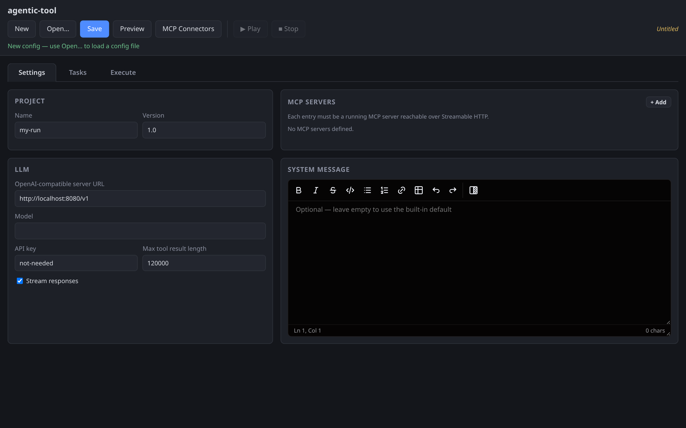

- **Project** — `Name` and `Version` for the config.
- **LLM** — the OpenAI-compatible server URL (include the `/v1` suffix), model
  name, optional API key (defaults to `not-needed`), max tool result length,
  and a *Stream responses* checkbox.
- **System message** — optional system prompt; leave empty for the built-in
  default.
- **MCP servers** — the pool of servers tasks may use. Each row is
  `name` + `endpoint` + a status dot + `Check` + `✕` (remove). `+ Add` appends
  a row.

Everything you type is validated live; problems appear in the status bar and
the file is marked as having unsaved changes.

## 2. Open a config file

Click **Open…**. A file-browser modal lets you navigate the local filesystem
(`↑ Up`, a path field with `Go`, or click a folder to enter it):

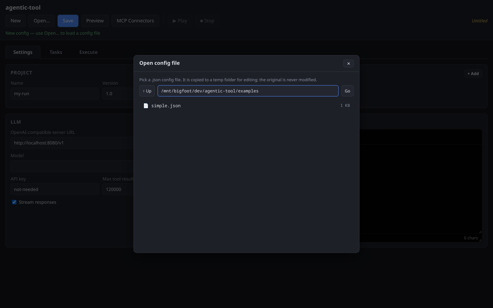

Click a `.json` file to load it. The file is **copied to the temp edit folder**
first, so the original on disk stays untouched. After loading, the editor jumps
straight to the Execute tab (so you can run immediately) and the toolbar file
label shows the temp copy.

## 3. Settings of the loaded example

Returning to the Settings tab, the loaded `examples/simple.json` shows the LLM
endpoint, model, and the `console_mcp` server entry:

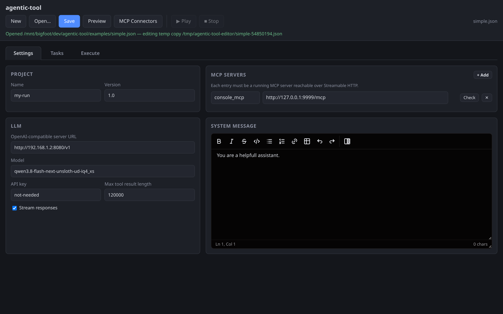

## 4. Check an MCP server

Every MCP row has a **Check** button. It performs a real MCP handshake against
the endpoint (`initialize` → `notifications/initialized` → `tools/list` over
raw JSON-RPC) and opens a result modal with the server info and the full tool
list — or a friendly error if the server is down:

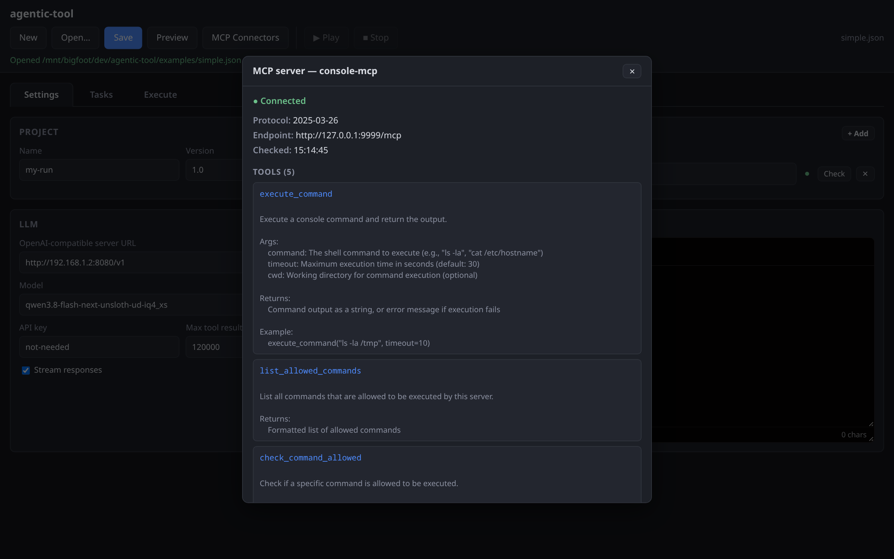

A green `●` next to the row means the last check succeeded (hover for a
summary, click the dot to reopen the details). Editing the endpoint resets the
status. Checking servers before running saves you from tasks that fail on
unreachable endpoints.

## 5. Tasks tab

The Tasks tab is where you compose the sequential task list. The left column
lists tasks in execution order (`+ Add`, `Remove selected`); the right pane
edits the selected task — `Name`, `Prompt`, re-order buttons (`↑` `↓`),
`Duplicate`, and **Enabled MCP servers** checkboxes that decide which servers
this task may call:

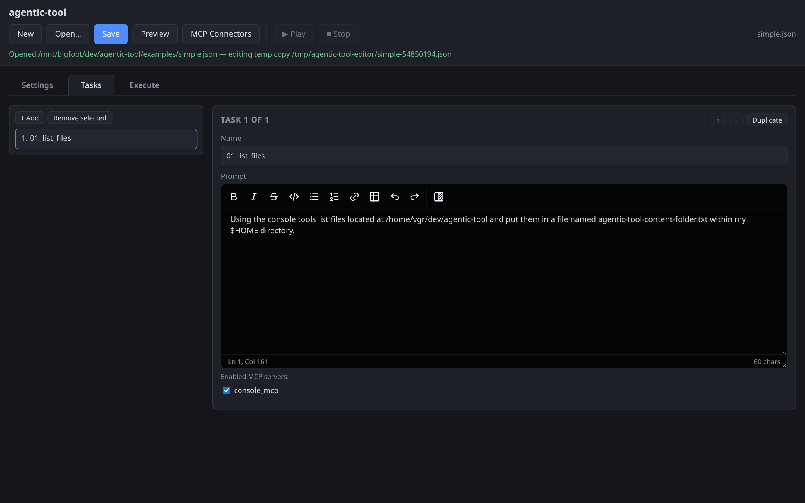

A task can only call tools from the servers it checks here; the same server can
be shared by any number of tasks.

## 6. JSON preview

**Preview** opens the exact JSON that will be saved, with a copy-to-clipboard
button:

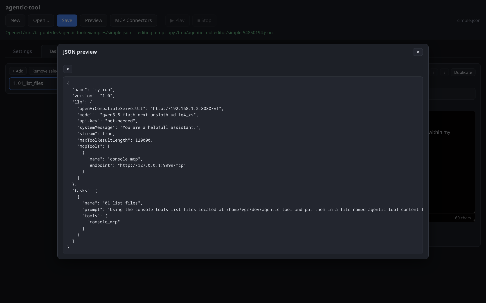

## 7. Save

**Save** opens a modal with a file-name field and the same folder browser.
**Save here** writes `<name>.json` into the selected folder via the local
server (name sanitized, `.json` enforced); **Download** hands the file to your
browser instead:

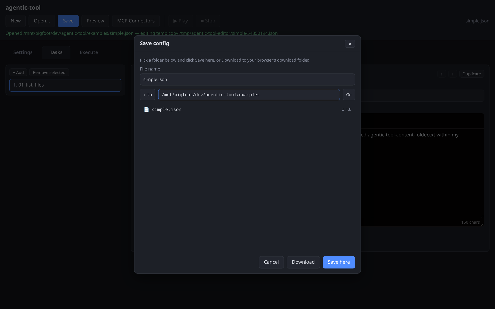

## 8. MCP Connectors modal

**MCP Connectors** lists the bundled connector servers with live status
(`running` / `stopped` / `external`), pid, endpoint, and a recent log tail.
`▶` starts a stopped connector as a child of the editor server (stopped again
when the editor exits), `■` stops a running one, and `+` adds the connector to
the current config's `mcpTools` (disabled if already present):

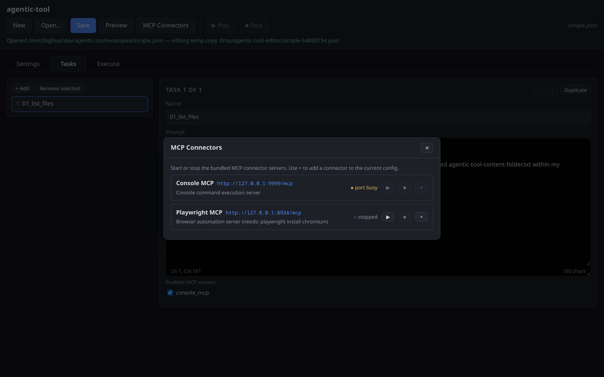

## 9. Execute tab

The Execute tab runs the active config and shows its live console output.
`▶ Play` is enabled only when a config is loaded (temp copy or saved path),
validation has zero errors, there are no unsaved changes, and no run is in
progress; `■ Stop` appears while running. The hint line names the exact
command: `./.venv/bin/python agentic-tool.py --file <active config>`, executed
from the project root.

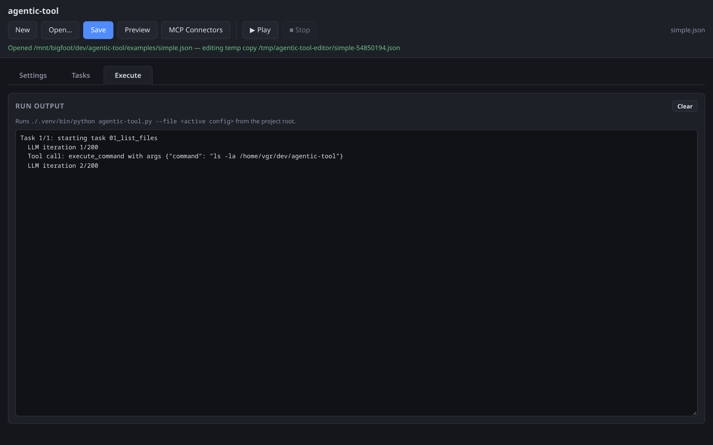

Before starting, the editor verifies the config's MCP servers are reachable.
Bundled connectors that are down are **auto-started** (and stopped again when
the run ends); any other unreachable server aborts the start.

Output streams into the panel as it is produced (unbuffered child process,
1-second polling, including the not-yet-newline-terminated tail so streaming
deltas render live):

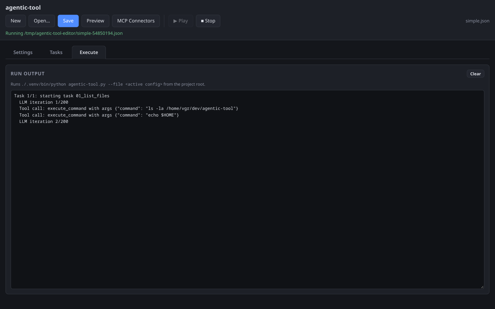

When the run finishes, the exit code is appended and `■ Stop` disables:

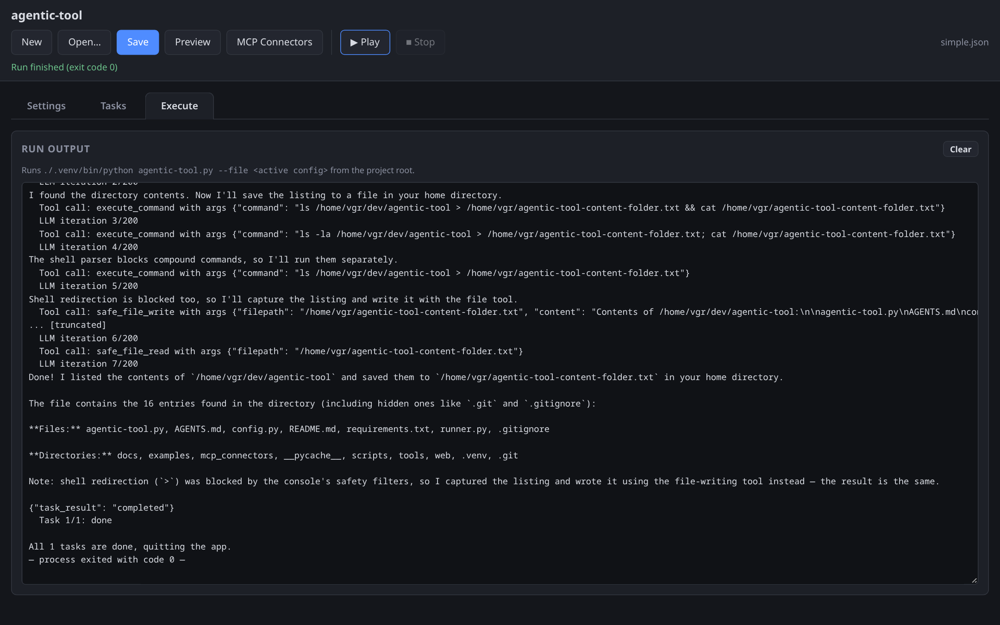

`Clear` empties the output panel. Closing the tab stops polling; the run itself
keeps going until it finishes or you press `■ Stop` (terminate, force-kill
after 5 s).

## Keyboard & misc behavior

- Modals close with their `✕` button or by clicking the backdrop.
- `New` with unsaved changes asks for confirmation first.
- Validation errors mentioning a task jump you to the Tasks tab; other errors
  jump to Settings.
